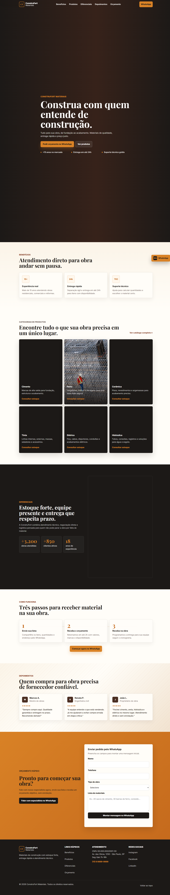

# Jockey Pães

Site institucional da Jockey Pães, pensado para negócio local e focado em pedidos rápidos, leitura fácil no mobile e apresentação comercial para clientes.

## Demonstração

- Link do projeto: https://padaria-jocker.vercel.app/
- Fluxo principal: cardápio, prova social, diferenciais, localização e WhatsApp
- Posicionamento: padaria de bairro com visual acolhedor e conversão direta

## Problema resolvido

Antes, a presença digital de uma padaria poderia depender de telefone, redes sociais soltas ou mensagens sem contexto. Este projeto resolve isso com uma página única, clara e orientada a ação, ajudando o cliente a pedir mais rápido e entender a oferta sem esforço.

## Solução aplicada

- Hero com proposta comercial clara
- Produtos organizados por categoria
- CTA forte para WhatsApp
- Seção de diferenciais para gerar confiança
- Depoimentos e mapa para reforçar credibilidade local
- Estrutura mobile-first e responsiva

## Tecnologias usadas

- React
- TypeScript
- Vite
- Tailwind CSS
- Motion
- Lucide React

## Principais melhorias

- Identidade visual mais consistente e profissional
- SEO básico com `title`, `description`, Open Graph e Twitter Cards
- Navegação adaptada para desktop e mobile
- CTA fixa de WhatsApp para conversão imediata
- Rodapé com contatos e links úteis
- Arquivos públicos preparados para deploy na Vercel

## Screenshots

### Desktop



### Mobile


## Como rodar localmente

### Pré-requisitos

- Node.js 18+
- npm

### Instalação

```bash
npm install
```

### Desenvolvimento

```bash
npm run dev
```

Abra `http://localhost:3000`.

### Build de produção

```bash
npm run build
npm run preview
```

## Checklist de testes

Veja o arquivo [TEST-CHECKLIST.md](TEST-CHECKLIST.md).

## Melhorias futuras

- Página de promoções semanais
- Integração com cardápio dinâmico
- Captura de pedidos por formulário
- Geolocalização com rota aberta no mapa
- Depoimentos gerenciados por painel simples
